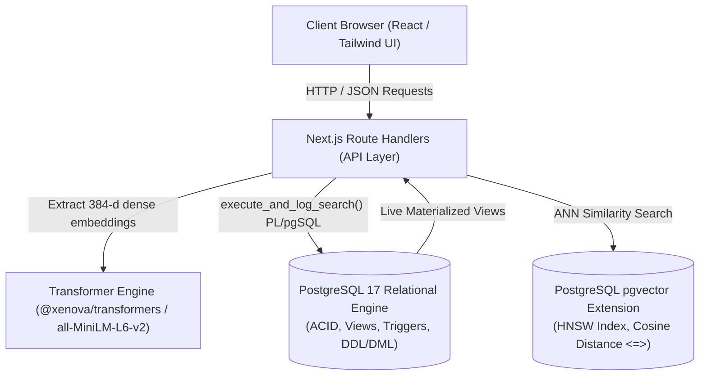

# System Architecture & Technical Specifications

**Project Title:** Campus Research Repository and Semantic Search System  
**Course:** DBMS Experiential Learning – Level 3 Mini-Project

### Abstract
> This Next.js-based web application manages role-based access for users such as Admin and Student to handle academic research papers. It implements a multi-paradigm database architecture combining a mandatory PostgreSQL SQL database for structured relational data with a vector database for vector embeddings and semantic search. The system executes database operations through DDL and DML statements while demonstrating advanced database features including transactions, views, stored procedures, and vector similarity search. Data integrity and security are enforced via database-level input validation, environment variables for sensitive configurations, and secure credential handling. Source code, implementation tracking, and documentation are maintained using Git and GitHub.

---

## 1. Architectural Overview

The Campus Research Repository is built using a unified SQL + Vector database paradigm powered by PostgreSQL 17 and `pgvector`, paired with a Next.js (App Router) full-stack web layer.

---

## 2. Advanced Database Features Demonstrated

1. **Vector Indexing (HNSW):**
   - Implemented using Hierarchical Navigable Small World graphs (`idx_vector_embedding_hnsw`) with parameters `m = 16, ef_construction = 64` on cosine distance operator class (`vector_cosine_ops`).
2. **PL/pgSQL Stored Procedures & Functions:**
   - `match_papers()`: Computes cosine similarity `1 - (vector_data <=> query_embedding)` and returns ranked matches.
   - `execute_and_log_search()`: Encapsulates query logging into `search_query` and candidate ranking into `query_retrieval` in a single transactional unit.
3. **Automated Triggers:**
   - `trg_users_updated_at` & `trg_research_paper_updated_at`: Maintains modification timestamps.
   - `trg_audit_paper_changes`: Enterprise audit trigger capturing `UPDATE` and `DELETE` actions into `paper_audit_log`.
4. **Analytical SQL Views:**
   - `view_paper_analytics`: Multi-table aggregation calculating total retrievals, unique researchers reached, and average similarity scores using `GROUP BY`, `LEFT JOIN`, `COUNT`, and `AVG`.
   - `view_recent_search_activity`: Correlated subquery fetching the top-ranked paper per query log.
   - `view_category_insights`: Aggregation by domain demonstrating `GROUP BY` and `HAVING`.
5. **Hybrid Search:**
   - Combines traditional PostgreSQL Full-Text Search (`to_tsvector` + `GIN` index) with Vector Cosine Distance (`<=>`).
